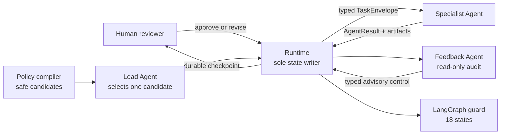

# Auto Make Passage

[](https://github.com/Chichu-LX/auto-make-passage/actions/workflows/ci.yml)
[](https://www.python.org/)
[](LICENSE)
[](docs/architecture.md)
[](project/tests)

**An auditable, human-governed multi-agent runtime for the complete research lifecycle.**

Auto Make Passage coordinates literature discovery, hypothesis generation, research design,
data acquisition, implementation, experiment execution, evidence checking, paper writing, and
peer review. The language model proposes decisions; deterministic policy and the Runtime own
state changes.

[简体中文](README.zh-CN.md) · [Architecture](docs/architecture.md) ·
[State machine](docs/state-machine.md) · [Security model](docs/security-model.md) ·
[Showcase](docs/showcase.md)

> Status: research prototype (`v0.1.0`). Live runs can call paid model/search services and can
> launch local or explicitly configured remote jobs. Human review is enabled by default.

## Why this is different

| Conventional agent pipeline | Auto Make Passage |
|---|---|
| Model output directly drives the next tool | The Lead selects only from policy-compiled transition candidates |
| A successful response is treated as truth | Pydantic contracts, evidence manifests, hashes, and deterministic checkers validate claim-to-evidence provenance and consistency |
| One autonomous run from prompt to paper | Every Specialist and Feedback result reaches an independent human checkpoint |
| Recovery means starting again | Versioned snapshots and idempotent checkpoints resume without rerunning completed work |

## Architecture



The control plane has three explicit layers:

1. **Semantic scheduling** — the Lead explains which allowed transition best fits the evidence.
2. **Specialist execution** — 12 domain Agents produce typed artifacts within isolated write scopes.
3. **Runtime governance** — schema, version, topology, dependency, retry, and permission checks are
   applied before any state is committed.

Read the full [architecture walkthrough](docs/architecture.md).

## Research workflow

```text
download-paper → make-idea → idea-design → download-data → code-make
  → code-review → server-schedule → check-result → experiment-code-run
  → write-paper → check-paper-and-code → paper-review
```

Each stage can enter `AWAITING_USER_REVIEW`; typed failures can route only to an allowlisted repair
stage. Main experiments must pass the result gate before supplementary experiments run. Paper
claims are reconstructed from persisted observations and linked to reviewed Python AST symbols.

## Quick start

Requirements: Python 3.12 and Git.

```bash
git clone https://github.com/Chichu-LX/auto-make-passage.git
cd auto-make-passage/project
python3.12 -m venv .venv
.venv/bin/python -m pip install -e .

# Deterministic and API-free after dependencies are installed: run one Agent and pause.
.venv/bin/python -m research_agents demo \
  --topic "Auditable multi-agent research"
```

The command prints a `run_id`. Inspect the durable checkpoint and approve one step:

```bash
.venv/bin/python -m research_agents status --run-id <run_id>
.venv/bin/python -m research_agents review \
  --run-id <run_id> \
  --verdict satisfied \
  --rating 5 \
  --comment "Evidence accepted."
```

Run the complete API-free workflow only in test/CI mode:

```bash
.venv/bin/python -m research_agents demo \
  --topic "Auditable multi-agent research" \
  --auto-approve
```

See [project/README.md](project/README.md) for live providers, remote execution, monitoring, and
recovery commands.

## Evidence and safety boundaries

- Model outputs use strict Pydantic/JSON Schema contracts with unknown fields rejected.
- `run_id` and observed state versions reject stale or cross-run decisions.
- Artifact writes are scoped per Agent and re-read with SHA-256 verification.
- Download paths defend against SSRF, private redirects, MIME spoofing, oversized bodies,
  symlink escape, and archive path traversal.
- Process logs are partitioned by run/Agent and redact prompts, credentials, document bodies,
  dataset rows, and result payloads.
- Optional third-party Skills are represented by source registries only. Their contents are not
  redistributed, downloaded, activated, or executed by default.

The threat model and non-goals are documented in [docs/security-model.md](docs/security-model.md).

## Verification

The repository contains 182 deterministic tests covering state transitions, stale decisions,
provider contract drift, human review, checkpoint recovery, download security, code review,
experiment gates, and paper/code/result consistency.

```bash
cd project
.venv/bin/python -m unittest discover -s tests -v
.venv/bin/python scripts/check_open_source_release.py
```

## Showcase artifact

The repository includes a bounded DTA evidence-provenance demonstration:

- [Manuscript PDF](project/paper/dta-live-pipeline-check-v2/strictcoldcal_ieee/manuscript.pdf)
- [LaTeX source](project/paper/dta-live-pipeline-check-v2/strictcoldcal_ieee/manuscript.tex)
- [Evidence summary](project/paper/dta-live-pipeline-check-v2/strictcoldcal_ieee/evidence_summary.json)
- [Artifact manifest](project/paper/dta-live-pipeline-check-v2/strictcoldcal_ieee/artifact_manifest.json)

The rendered manuscript carries persisted observations from a Davis-only local CPU pilot. KIBA
and Metz are materialized inputs, not executed results. The study deliberately makes no SOTA claim:
it demonstrates that the pipeline can preserve this claim boundary from evidence to paper.

## Repository layout

```text
project/agents/           14 auditable Agent packages
project/research_agents/  Runtime, state machine, providers, storage, and logging
project/scripts/          Schema export, release audit, replay, and validation tools
project/tests/            Unit, integration, and offline end-to-end tests
docs/                     Architecture, state, security, and showcase documentation
```

Runtime outputs (`reference/`, `data/`, `design/`, `code/`, logs, state, credentials, and local
compute environments) are intentionally excluded from version control.

## Contributing and responsible use

Read [CONTRIBUTING.md](CONTRIBUTING.md) before opening a pull request. Report vulnerabilities
through the process in [SECURITY.md](SECURITY.md). This software assists research workflows; it
does not replace scientific judgment, ethics review, data-use authorization, or venue policy.

## License and citation

Original project code and documentation are available under the [MIT License](LICENSE). External
dependencies, the LPPL IEEE template, and registry-linked Skills retain their own terms; see
[THIRD_PARTY_NOTICES.md](THIRD_PARTY_NOTICES.md). Citation metadata is available in
[CITATION.cff](CITATION.cff).
