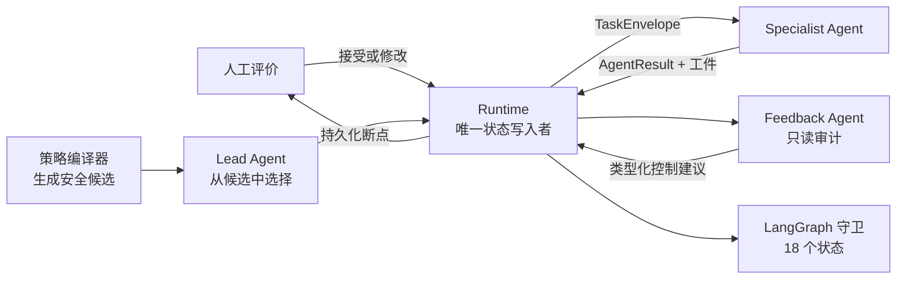

# Auto Make Passage

[](https://github.com/Chichu-LX/auto-make-passage/actions/workflows/ci.yml)
[](https://www.python.org/)
[](LICENSE)
[](docs/architecture.md)
[](project/tests)

**面向完整科研生命周期的可审计、人工治理型多智能体 Runtime。**

系统覆盖文献检索、创新点生成、研究方案设计、数据获取、代码实现、实验执行、结果验证、
论文撰写与同行评审。大模型负责提出语义决策，确定性策略和 Runtime 掌握状态控制权。

[English](README.md) · [架构](docs/architecture.md) · [状态机](docs/state-machine.md) ·
[安全模型](docs/security-model.md) · [项目展示](docs/showcase.md)

> 当前版本为研究原型 `v0.1.0`。真实运行可能调用付费模型/检索服务，或在显式配置后启动
> 本地及远程实验；系统默认开启人工评价门禁。

## 核心差异

| 常见 Agent Pipeline | Auto Make Passage |
|---|---|
| 模型输出直接决定下一个工具 | Lead 只能从状态机编译出的合法候选中选择 |
| 返回成功即认为任务完成 | 使用强类型合同、证据清单、哈希和确定性检查器验证主张—证据来源及一致性 |
| 从 Prompt 一次运行到论文 | 每个 Specialist 与 Feedback 结果均有独立人工检查点 |
| 中断后重新开始 | 通过版本化快照与幂等 Checkpoint 从断点继续 |

## 三层架构



1. **语义调度**：Lead 根据证据判断哪个合法迁移最符合当前语义。
2. **专业执行**：12 个业务 Agent 在隔离的写入范围内生成结构化工件。
3. **运行时治理**：提交状态前校验 Schema、状态版本、拓扑、依赖、重试预算和权限。

## 科研主流程

```text
论文获取 → 创新生成 → 方案设计 → 数据获取 → 代码实现 → 代码审查
→ 主实验调度 → 结果检查 → 补充实验 → 论文撰写 → 一致性审查 → 最终审稿
```

每个阶段都可进入 `AWAITING_USER_REVIEW`。失败结果只能回到白名单允许的修复阶段；
主实验通过结果门禁后才能启动补充实验。论文公式、实验数字和结论会绑定到经审查的代码符号
与持久化观测，而不是直接相信模型生成的文本。

## 快速体验

需要 Python 3.12 与 Git：

```bash
git clone https://github.com/Chichu-LX/auto-make-passage.git
cd auto-make-passage/project
python3.12 -m venv .venv
.venv/bin/python -m pip install -e .

# 依赖安装完成后不再调用模型/检索 API：运行一个 Agent 后暂停。
.venv/bin/python -m research_agents demo \
  --topic "可审计科研多智能体工作流"
```

命令会输出 `run_id`。查看并批准一次断点：

```bash
.venv/bin/python -m research_agents status --run-id <run_id>
.venv/bin/python -m research_agents review \
  --run-id <run_id> \
  --verdict satisfied \
  --rating 5 \
  --comment "证据通过，继续。"
```

完整配置、真实 Provider、远程执行、监控和故障恢复见
[project/README.md](project/README.md)。

## 安全与可信性

- Pydantic/JSON Schema 强类型合同禁止未知字段，并将模型输出视为不可信提案。
- `run_id` 与状态版本阻止过期决策和跨运行污染。
- Agent 仅能写入自己的目录，工件再次读取时验证 SHA-256。
- 下载链路防护 SSRF、私网重定向、MIME 欺骗、超大文件、符号链接和压缩包穿越。
- 日志按 Run/Agent 隔离，并对密钥、Prompt、文档正文、数据行和结果正文脱敏。
- 第三方 Skill 仅保留来源、用途和固定 commit 的注册表；默认不下载、不激活、不执行，
  公开仓库也不再分发第三方脚本。

## 测试与展示

项目包含 182 项确定性测试，覆盖非法状态迁移、模型协议漂移、人工门禁、断点恢复、下载安全、
代码审查、实验门禁及论文—代码—结果一致性。

```bash
cd project
.venv/bin/python -m unittest discover -s tests -v
.venv/bin/python scripts/check_open_source_release.py
```

仓库保留了一份由流程生成的、严格限定结论边界的 DTA 演示论文：

- [论文 PDF](project/paper/dta-live-pipeline-check-v2/strictcoldcal_ieee/manuscript.pdf)
- [LaTeX 源码](project/paper/dta-live-pipeline-check-v2/strictcoldcal_ieee/manuscript.tex)
- [证据汇总](project/paper/dta-live-pipeline-check-v2/strictcoldcal_ieee/evidence_summary.json)
- [工件清单](project/paper/dta-live-pipeline-check-v2/strictcoldcal_ieee/artifact_manifest.json)

论文仅承载 Davis 本地 CPU 小规模试验的持久化观测；KIBA 与 Metz 只是已物化输入，不是
已运行结果。它不宣称达到 SOTA，而是展示如何把这一结论边界一直保存到最终论文。

## 参与项目

贡献方式见 [CONTRIBUTING.md](CONTRIBUTING.md)，安全问题见 [SECURITY.md](SECURITY.md)。
原创代码与文档采用 [MIT License](LICENSE)；第三方内容说明见
[THIRD_PARTY_NOTICES.md](THIRD_PARTY_NOTICES.md)。
