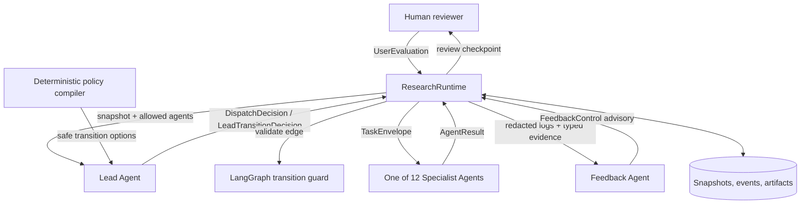

# Architecture

Auto Make Passage separates open-ended model reasoning from deterministic control. A language
model may interpret evidence and choose among options, but it cannot directly mutate workflow
state, expand its write scope, or invent an executable transition.

## System overview

## Control-plane invariants

### 1. Policy compiles; Lead selects

The state machine constructs complete candidate snapshots from allowlisted transitions. The Lead
receives immutable `LeadTransitionOption` values and selects one by ID. During commit, the Runtime
checks that the returned run, observed version, phase, action, target state, and target Agent exactly
match the selected candidate. A modified or stale option is rejected without a state write.

### 2. Runtime is the sole state authority

Agents return typed results; they never receive a state-writing tool. `ResearchRuntime` validates
the result, asks the Lead to select a policy-safe transition, persists events, and atomically saves
the next snapshot. The same rule applies to Feedback and human-review transitions.

### 3. Work is passed through typed contracts

The main control contracts are:

| Contract | Purpose |
|---|---|
| `DispatchDecision` | Lead's task dispatch or wait/escalation decision |
| `LeadTransitionOption` | One state-machine-compiled safe candidate |
| `LeadTransitionDecision` | Lead's semantic selection among candidates |
| `TaskEnvelope` | Objective, inputs, acceptance criteria, write scope, attempt, and deadline |
| `AgentResult` | Status, artifacts, evidence, issues, and optional route hint |
| `FeedbackControl` | Read-only `continue`, `retry`, `request_human`, or `abort` advice |
| `UserEvaluation` | Version-bound human approval or actionable revision request |
| `RunSnapshot` | Durable workflow state, artifacts, attempts, review queue, and history |

Pydantic models use `extra="forbid"`; JSON Schema copies are exported into Agent packages so the
model prompt, implementation, and reviewer can share the same machine-readable boundary.

## Agent topology

There are 14 roles: one Lead, 12 workflow Specialists, and one independent Feedback coordinator.

| Role | Input responsibility | Primary output |
|---|---|---|
| Lead | Snapshot and policy-safe options | Dispatch/transition decision |
| Download Paper | Search results and source policy | Verified paper manifest |
| Make Idea | Hashed paper evidence | Ranked falsifiable ideas |
| Idea Design | Selected idea and evidence | Executable research design |
| Download Data | Dataset requirements | Licensed dataset manifest and profile |
| Code Make | Design and data contracts | Implementation manifest |
| Code Review | Generated code and design | Static/deterministic review report |
| Server Schedule | Reviewed code and server policy | Main-job schedule manifest |
| Check Result | Persisted main-job observations | Result gate report |
| Experiment Code Run | Passed main result and experiment plan | Supplementary run report |
| Write Paper | Verified literature, code, and results | Markdown/LaTeX/BibTeX manuscript set |
| Check Paper and Code | Manuscript plus upstream evidence | Independent consistency report |
| Paper Review | Passed consistency report and paper | Typed venue-style review |
| Feedback | Redacted logs and typed stage result | Advisory control and coordination report |

## Data plane and provenance

Artifacts use `artifact://` references and carry SHA-256 digests. `ArtifactStore` resolves paths
inside Agent-specific write scopes, rejects traversal and symlink escape, and verifies content when
an artifact is read. Each research run receives a project namespace so unrelated runs do not share
paper, data, design, code, or review outputs.

The event layer stores:

- a versioned snapshot for safe resume;
- an append-only workflow timeline;
- per-Agent JSONL process logs;
- Agent results and feedback coordination reports;
- pending and queued human-review requests.

## Failure and recovery

Transient provider failures use bounded retries. Typed stage failures are mapped to allowlisted
repair routes. Invalid control output fails closed. If a process stops after a result is persisted
but before the next checkpoint commits, the recovery path reuses the saved result instead of
rerunning the model or experiment. Long-running experiment loops have human checkpoints rather
than arbitrary fixed retry counts.

## Extension points

- Add a model provider by implementing the JSON model protocol.
- Add a Specialist by defining its Agent package, contracts, write scope, and state edges.
- Add a domain quality adapter without weakening the domain-independent evidence gates.
- Add a remote execution backend behind the disabled-by-default scheduling policy.

Any extension that can change state or write artifacts must remain behind Runtime validation.
