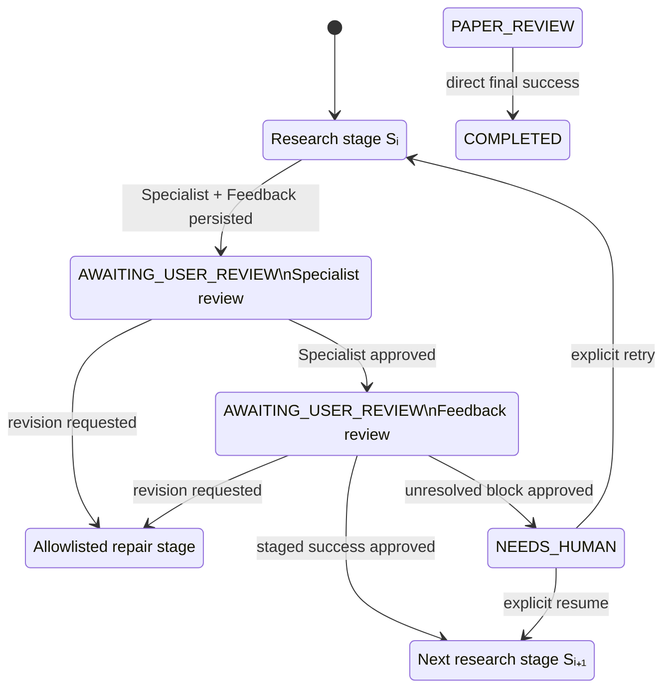

# State machine

The executable topology contains **18 workflow states**: 12 research states, two human-control
states, and four terminal states. LangGraph also adds one conditional guard node; the guard is
executable routing infrastructure, not a nineteenth state.

## The 12 research states

Every successful research stage follows the same governed commit pattern: the Specialist result
and the independent Feedback result are persisted, then two user reviews are processed in order.
Only after both approvals does the staged next state become active.

| State | Purpose and entry condition | Successful exit | Principal repair exits |
|---|---|---|---|
| `ACQUIRING_PAPERS` | Initial state, or re-entry when a later stage finds a literature gap; discovers and verifies source papers. | Accepted paper manifest → `IDEATING` | Retry paper acquisition; otherwise `NEEDS_HUMAN` or `ABORTED`. |
| `IDEATING` | Enters with hashed paper evidence; produces ranked, falsifiable research candidates. | Accepted idea proposal → `DESIGNING_IDEA` | Return to `ACQUIRING_PAPERS` or retry `IDEATING`. |
| `DESIGNING_IDEA` | Enters with a selected candidate; turns it into an executable method, data, evaluation, and risk plan. | Accepted research design → `ACQUIRING_DATA` | Return to papers or ideas, or retry design. |
| `ACQUIRING_DATA` | Enters with dataset requirements; verifies licensing, format, signatures, size, and profiles. | Accepted dataset manifest → `IMPLEMENTING` | Return to design or retry acquisition. |
| `IMPLEMENTING` | Enters with accepted design and data contracts; generates scoped research code and a manifest. | Accepted implementation → `CODE_REVIEW` | Return to design/data or retry implementation. |
| `CODE_REVIEW` | Enters with generated code; performs static, security, design-alignment, and deterministic checks. | Passing review → `RUNNING` | Return to `IMPLEMENTING` or repeat review. |
| `RUNNING` | Enters only after code review; validates compute policy, stages the main benchmark, and monitors jobs. | Persisted main-run observations → `RESULT_CHECK` | Return to implementation or retry scheduling/execution. |
| `RESULT_CHECK` | Enters with persisted main-job observations; checks metrics, completeness, provenance, and design gates. | Passed main-result gate → `EXPERIMENT_CODE_RUN` | Return to idea, design, data, code, running, or repeat the check. |
| `EXPERIMENT_CODE_RUN` | Enters after the main-result gate; audits coverage and runs declared supplementary experiments. | Accepted supplementary evidence → `WRITING` | Return to design, data, code, main run/result check, or retry experiments. |
| `WRITING` | Enters with reviewed literature, code, and observations; generates evidence-bound Markdown/LaTeX/BibTeX. | Accepted manuscript → `CONSISTENCY_REVIEW` | Return to papers, result checks, experiments, or rewrite. |
| `CONSISTENCY_REVIEW` | Enters with a manuscript; reconstructs citations, AST symbols, formulas, result rows, and claim provenance. | Passing consistency report → `PAPER_REVIEW` | Rewrite/recheck; Feedback may also route to code or supplementary experiments. |
| `PAPER_REVIEW` | Enters only after consistency passes; applies venue-style quality criteria and blocking/major issue gates. | Two approved reviews with no blocking gate → `COMPLETED` | Return to papers, ideas, design, experiments, writing, consistency review, or repeat peer review. |

Repair targets are not free-form suggestions. They are compiled from
`CONTROLLED_FAILURE_ROUTES` and `FEEDBACK_RETRY_ROUTES`; the Runtime rejects any target not present
in the allowlist. Bounded stages normally allow three gate attempts, code review allows five, and
long-running experiment/review loops remain human-gated instead of using an arbitrary fixed cap.

## The two human-control states

| State | Entry condition | Exit semantics |
|---|---|---|
| `AWAITING_USER_REVIEW` | A typed Specialist/Feedback result and proposed transition have been durably staged. | `satisfied` activates the queued review or staged state; `needs_revision` rolls back only to an allowlisted repair stage. Evaluations are bound to `run_id`, `review_id`, and observed version. |
| `NEEDS_HUMAN` | Automatic progress is unsafe or impossible: exhausted budget, unresolved policy/evidence gap, or an accepted escalation. | An explicit human may resume to the recorded next stage or retry the blocked stage; the Runtime still validates the edge. |

## The four terminal states

| State | Meaning and entry condition |
|---|---|
| `COMPLETED` | Final paper review and both associated human gates passed. |
| `CANCELLED` | Reserved terminal snapshot marker. The current Runtime/CLI recognizes it as terminal but does not expose a transition that creates it. |
| `ABORTED` | A validated control decision intentionally stopped the run. |
| `FAILED` | An unrecoverable Runtime/system failure ended the run. |

## Governed transition pattern

The following diagram shows one generic research stage rather than drawing the same two-review
cycle twelve times. `Sᵢ₊₁` is the stage's allowlisted success target; a repair target can be the
same stage or an earlier dependency stage.



The concrete success chain is:

```text
ACQUIRING_PAPERS → IDEATING → DESIGNING_IDEA → ACQUIRING_DATA
→ IMPLEMENTING → CODE_REVIEW → RUNNING → RESULT_CHECK
→ EXPERIMENT_CODE_RUN → WRITING → CONSISTENCY_REVIEW → PAPER_REVIEW → COMPLETED
```

Direct edges in the compiled topology represent the staged proposal being checked. In normal
execution the Runtime still converts each Specialist/Feedback cycle into the durable
`AWAITING_USER_REVIEW` checkpoints shown above before accepting the proposal. A successful
Specialist followed by Feedback's `request_human` is a special case: approving the Specialist gate
explicitly overrides that escalation to the stage's normal success target before the queued
Feedback review is activated. `NEEDS_HUMAN` therefore represents an unresolved accepted block,
not an unavoidable result of every Feedback escalation.

## Why a graph guard exists

Checking a target string in prompt code is insufficient because model output can drift. Every
selected transition is invoked through the compiled LangGraph topology. The guard rejects an edge
unless `(source_state, target_state)` is in the deterministic allowlist.

Version checks add optimistic concurrency control: a decision based on snapshot version `N` cannot
commit after another action has produced version `N+1`.

Inspect the runtime topology locally:

```bash
cd project
.venv/bin/python -m research_agents graph
```
